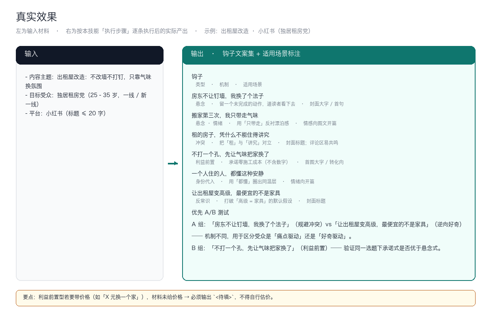

# 钩子文案

> 为内容生成黄金 3 秒开场钩子与引流钩子文案集，直接决定完播与点击
>
> L1 原子技能　·　复杂度 S　·　阶段 P0　·　可见性 platform_shared　·　版本 v1.0.0



*本技能为纯提示词技能，无可执行业务脚本——上图为**真实效果**：左侧是输入材料，右侧是按「执行步骤」逐条执行后的实际产出（共 3 组，全量见 `docs/使用示例.md`）。*

---

## 验收状态

本技能的验收口径见本仓 `docs/05-验收与测试.md`；测试用例见 `skills/hook-copy/tests/cases.yaml`。

---

## 解决什么问题

| 现实痛点 | 本技能的做法 |
|---|---|
| 「开头 3 秒」没有客观标准，全靠感觉写，写完成不成全凭运气 | 按 5 类机制（悬念 / 冲突 / 利益前置 / 身份代入 / 反常识）分类产出，每条标注预期心理机制，可以按机制复盘为什么这条有效 |
| 同一个人写钩子会形成固定套路，连用几次就被受众识别出来 | 一次给 ≥6 条并显式标注机制差异，方便轮换；机制维度摆出来，避免无意识重复同一种 |
| 写完一堆钩子，不知道先测哪条 | 直接给 A/B 分组：哪两条优先测、分别在验证什么假设（痛点驱动 vs 好奇驱动） |

---

## 快速开始

### 1. 安装（五平台通用）

本技能是**标准 Agent 技能**：目录名 == `name`、只使用标准字段、正文里没有任何平台专有工具名。因此同一份目录可以直接用于下列平台：

| 平台 | 安装方式 |
|---|---|
| WorkBuddy | 把技能目录放到 `~/.workbuddy/skills/`，或在对话里直接说触发词 |
| ChatGPT | 打包为 zip 后在 Skills 设置里上传（需支持 Skills 的版本） |
| DeepSeek Harness | `新建技能 安装:<repo-url>`，或把目录放进 harness 的 skills 目录 |
| Kimi Work | 上传 zip 或放置到技能目录；注意 Kimi Work 不会自动触发，需显式点名技能 |
| 豆包工作 | `新建技能 安装:<repo-url>`，或在技能管理处上传 zip |

```bash
# 通用做法：把本目录整体复制到目标平台的 skills 目录
cp -r hook-copy <平台技能目录>/hook-copy
```

### 2. 在你的 Agent 里调用

**方式一 · 自动触发**（description 里已写好中英触发词）：

```text
钩子文案　开场钩子　黄金3秒　引流钩子　开头怎么写
```

**方式二 · 显式点名**（Kimi Work 不会自动调用，必须用这条）：

```text
用 hook-copy 技能帮我处理：<你的材料>
```

### 3. 真实跑一次（本仓库最推荐的一步）

本技能为**纯提示词技能**，没有可执行脚本。验证方式是把技能装到目标平台后，用上面的触发词跑一次，并对照 `## 输出物长什么样` 的契约逐项检查。

```bash
# 平台兼容校验（本仓库对每个技能都跑过）；需在技能库根目录执行
python3 tests/run.py
```

---

## 输出物长什么样（真实产出）

**钩子文案集 + 适用场景标注**

下面是**真实产出**（示例输入：出租屋改造 · 小红书（独居租房党））：

```markdown
| 钩子 | 类型 | 机制 | 适用场景 |
|---|---|---|---|
| 房东不让钉墙，我换了个法子 | 悬念 | 留一个未完成的动作，逼读者看下去 | 封面大字 / 首句 |
| 搬家第三次，我只带走气味 | 悬念 · 情绪 | 用「只带走」反衬漂泊感 | 情感向图文开篇 |
| 租的房子，凭什么不能住得讲究 | 冲突 | 把「租」与「讲究」对立 | 封面标题；评论区易共鸣 |
| 不打一个孔，先让气味把家换了 | 利益前置 | 承诺零施工成本（不含数字） | 首图大字 / 转化向 |
| 一个人住的人，都懂这种安静 | 身份代入 | 用「都懂」圈出同温层 | 情绪向开篇 |
| 让出租屋变高级，最便宜的不是家具 | 反常识 | 打破「高级 = 家具」的默认假设 | 封面标题 |

## 优先 A/B 测试
- A 组：「房东不让钉墙，我换了个法子」（规避冲突）vs「让出租屋变高级，最便宜的不是家具」（逆向好奇）
  —— 机制不同，用于区分受众是「痛点驱动」还是「好奇驱动」。
- B 组：「不打一个孔，先让气味把家换了」（利益前置）—— 验证同一选题下承诺式是否优于悬念式。
```

> 另外 2 组真实输入 / 输出见 [`docs/使用示例.md`](docs/使用示例.md)。

---

## 适用场景与不适用场景

**适用**

- 被以下数字员工引用：短视频脚本创作师、私域引流转化师、电商短视频/直播内容、探店短视频编导
- 需要**稳定输出结构**的场景：钩子文案集 + 适用场景标注
- 平台级公共能力，被 ≥2 个数字员工复用，改一处全库受益

**不适用（写清楚做不到什么，比列一堆能力更有用）**

- 不做虚假承诺式钩子（夸大收益、伪造数据）

---

## 已知陷阱（真实踩过的坑）

> 这一段比能力列表更有用：它们是从实际使用中撞出来的，交付前请逐条核对。

- 钩子与正文不匹配会造成高点击低完播，反噬推荐
- 同一钩子模板连用会被受众识别，需轮换

---

## 常见问题

**Q：为什么没有脚本？**

本技能的判断依赖语境理解（读语气、读潜台词、读平台调性）。这类事写成规则只会更不可靠，所以交给模型执行，用输出契约约束质量、用交付前自检项兜住下限。

**Q：输出不稳定怎么办？**

先按这个顺序查：① 输入是否满足「必填」清单——缺料时应当停下来问而不是猜；② 是否走到了降级路径（有脚本的技能会在结尾说明用了哪条）；③ 对照「输出物长什么样」的结构逐项核对，缺项要求补齐而不是接受。

**Q：怎么改才能不破坏跨平台性？**

三条：目录名 == frontmatter 的 `name`；只使用标准字段（name / description / license / compatibility / metadata）；正文里不出现任何平台专有工具名，平台差异下沉到 `references/`。改完跑一次平台兼容校验。

---

## 目录结构

```text
hook-copy/
├── SKILL.md                  # 技能定义（跨平台标准）
├── README.md
├── index.html                # 交付物导航页（浏览器打开）
├── site.json                 # 导航数据
├── docs/
│   ├── 使用手册.md / .html
│   ├── 使用示例.md / .html
│   ├── 用户场景.md / .html
│   ├── 架构与流程图.md / .html
│   └── images/               # 架构图 / 流程图 / 决策矩阵 / 终端截图 / 录屏
├── references/
│   └── architecture.md       # 字段、脚本、依赖速查
├── examples/
│   ├── input/                # 真实运行夹具
│   └── output/               # 真实抓取的命令输出
├── demo/
│   └── walkthrough.html      # 演示页（真实会话回放）
```

---

## 合规与边界

- 许可：MIT；版本 v1.0.0
- 归属：短视频脚本创作师、私域引流转化师、电商短视频/直播内容、探店短视频编导
- 输出内容在对外发布前，**必须**按《广告法》与目标平台规则逐条人工复核
- 本技能不做平台官方审核的替代，只做发布前自查

---

## 深入了解

| 文档 | 用途 |
|---|---|
| `docs/使用手册.md` | 安装、参数总表、输出物说明、排错手册 |
| `docs/使用示例.md` | 可直接复制的示例，含真实运行输出节选 |
| `docs/用户场景.md` | 谁、什么时机、说什么、得到什么、注意什么 |
| `docs/架构与流程图.md` | 业务架构、执行流程、脚本与模型分工、扩展指南 |
| `references/architecture.md` | 字段、脚本、上下游依赖速查 |
| `SKILL.md` | 技能定义（触发词、能力边界、使用方式） |
| `demo/walkthrough.html` | 演示页：真实会话回放 |

演示录屏：`docs/images/08-demo-run.gif`（动图）· `docs/images/08-demo-run.mp4`（视频）
效果图：`docs/images/04-terminal-run.png`（环境能力探测）
